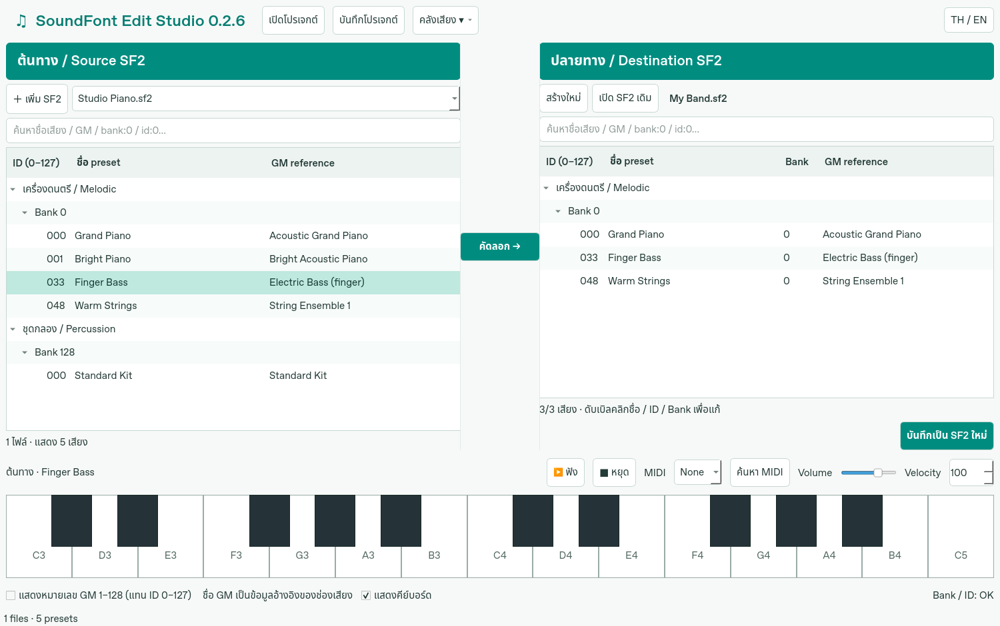

# SoundFont Edit Studio

แอปเดสก์ท็อป Windows สำหรับจัดคลัง SoundFont ทดลองเสียง และจัดชุด preset
หน้าตาโทนสว่างขาว–เขียวอมฟ้า พร้อมสลับปุ่มคำสั่งหลักไทย/อังกฤษ

**สถานะ: รุ่นทดลอง 0.2.6** สร้างใหม่จากขอบเขตที่ตกลงกัน ไม่ได้นำโค้ดจากโปรแกรมเดิมมาใช้



## ดาวน์โหลดสำหรับ Windows

เปิด [Windows build](../../actions/workflows/windows.yml) เลือกรอบที่สำเร็จล่าสุด
แล้วดาวน์โหลด `SoundFont-Edit-Studio-0.2.6-Windows` ในส่วน Artifacts
แตก ZIP ทั้งหมด แล้วเปิด `SoundFont-Edit-Studio.exe` โดยเก็บโฟลเดอร์ `_internal` ไว้ด้วยกัน
ใช้ Windows 10/11 แบบ 64 บิต ไม่ต้องติดตั้ง Python แยก

ตัว build รวม FluidSynth สำหรับเล่นเสียงไว้แล้ว ไฟล์ยังไม่ได้ลงลายเซ็นดิจิทัล
และยังต้องทดลองอุปกรณ์เสียง/MIDI จริงบนเครื่องของผู้ใช้

## แก้ไขใน 0.2.6: zone ต้นฉบับที่ start มากกว่า end

รายงานชุด Synth พบ Bank 0 / ID 82 อ้าง sample 812 ที่เลื่อนจุดเริ่มเกินจุดจบ
ตัวส่งออกเดิมปฏิเสธทั้งชุด แม้ตำแหน่งที่อ้างยังอยู่ภายใน PCM ที่มีจริง
รุ่นนี้คง offsets, generator, zone และช่วง PCM เดิมไว้ พร้อมแสดงคำเตือนหลังบันทึก
ไม่สลับ start/end ไม่ลบ zone และไม่สร้างเสียงใหม่แทนต้นฉบับ
กรณีอ้างเกินข้อมูล PCM ที่มีจริงยังปฏิเสธ เพื่อไม่เขียนไฟล์ที่ขาดข้อมูลเสียง

ตรวจโครงสร้างทุก 133 preset ในรายงานแล้ว: มี stereo links ที่ซ่อมได้ 5 คู่
และ zone นี้ 1 กรณี ไม่มีข้อผิดพลาดที่หยุดส่งออกหลังปรับนโยบายดังกล่าว
เพิ่มการเทียบ render ด้วย FluidSynth ของกรณีจำลอง ก่อนและหลังส่งออกได้ผลตรงกัน
การตรวจรายงานผู้ใช้ยังเป็น metadata-only เพราะรายงานไม่มี PCM เสียงจริง

## แก้ไขใน 0.2.5: ลิงก์สเตอริโอของไฟล์ recovered

รายงานผู้ใช้พบว่าลิงก์คู่สเตอริโอชี้ sample 2025 ทั้งที่มีเพียง 2021 sample
ตัวส่งออกเดิมจึงหยุดก่อนสร้างไฟล์ รุ่นนี้ตรวจและซ่อมเฉพาะลิงก์ที่ชี้เกินตาราง
เมื่อพบคู่ L/R ที่ตรงกันเพียงคู่เดียว โดยต้องตรงทั้งชื่อ (รองรับชื่อที่ท้ายถูกตัด),
ชนิดช่องเสียงตรงข้าม, จำนวนจุดเสียง, จุดลูปสัมพัทธ์, sample rate และ pitch
และต้องไม่แย่งคู่ที่มีลิงก์ถูกต้องอยู่แล้ว

แก้เฉพาะ header ในไฟล์ส่งออก โดยคง PCM, sample types และ zones เดิม
หลังสำเร็จแสดงจำนวนคู่ที่ซ่อมพร้อมรายละเอียดใน tooltip
กรณีไม่พบคู่ที่แน่นอนจะหยุดพร้อมข้อผิดพลาด ไม่ลบ sample หรือแปลงเป็น mono อัตโนมัติ

ตรวจโครงสร้างจากรายงานผู้ใช้: ชุด Bank 0 / ID 56–63 ส่งออกผ่านเมื่อซ่อม 5 คู่
การจำลองใช้ PCM ว่างแทนเสียงจริง จึงยืนยันโครงสร้างและขนาดได้ แต่ไม่ใช่การตรวจฟังไฟล์ผู้ใช้
ไม่มีข้อมูลรายงานผู้ใช้หรือ sample ส่วนตัวรวมอยู่ใน repository/build

## เพิ่มใน 0.2.4: รายละเอียดเมื่อบันทึกไม่สำเร็จ

หากส่งออกผิดพลาด จะแสดงสาเหตุค้างไว้ในหน้าต่างหลัก พร้อมปุ่ม **คัดลอกข้อผิดพลาด**
และ **บันทึกรายงานตรวจสอบ** ไม่ต้องพึ่งกล่องแจ้งเตือนแยกที่อาจไม่ปรากฏในวิดีโอ

รายงาน JSON มีข้อความ/traceback, preset ที่เลือก, ชื่อไฟล์ และตารางโครงสร้าง PDTA
รวมถึงความยาว PCM แต่ **ไม่มี sample เสียง** และไม่ได้อัปโหลดข้อมูลอัตโนมัติ
เก็บรายงานล่าสุดไว้ใน AppDataLocation ของแอปชื่อ `last-export-error.json` ด้วย
สามารถกดบันทึกรายงานแล้วแนบ JSON เพื่อวิเคราะห์กับไฟล์จริงโดยไม่ต้องส่ง SoundFont ใหญ่ทั้งไฟล์

รุ่นนี้เพิ่มข้อมูลสำหรับวินิจฉัย ยังไม่ได้ยืนยันสาเหตุที่ไฟล์ของผู้ใช้บันทึกไม่ผ่าน
และไม่ได้ผ่อนการตรวจข้อมูลหรือกลับไปคัดลอก sample ทั้งธนาคาร

## แก้ไขใน 0.2.3: ส่งออกเฉพาะข้อมูลเสียงที่ใช้งาน

รุ่นก่อนคัดลอกเฉพาะ preset ที่เลือก แต่ยังยก instrument/sample ทั้งไฟล์มา
จึงเห็นแค่เสียงที่เลือกในตัวเล่น แต่ขนาดไฟล์ยังใกล้เคียงต้นทาง

รุ่นนี้ตามความสัมพันธ์ **preset → instrument → sample** และเขียนเฉพาะส่วนที่ใช้
พร้อมตัด PCM ที่ไม่มีการอ้างอิง เก็บ sample ที่ใช้ร่วมกันในไฟล์เดียวครั้งเดียว
รักษาคู่สเตอริโอ global zones, modulators และ address/loop offsets โดยไม่ลดคุณภาพ PCM
อ่าน metadata และเขียน sample เป็นช่วงจากไฟล์ ไม่โหลด SoundFont ใหญ่ทั้งไฟล์เข้า RAM

ผลตรวจด้วย TimGM6mb.sf2 จริง: เลือก Bank 0 / ID 0–5 จาก 5,969,788 bytes
ได้ 261,540 bytes (6 preset, 9 instrument, 33 sample จากเดิม 520 sample)
ผล render ทั้ง 6 เสียงตรงกับต้นฉบับ และตรวจส่งออกครบ 136 preset แล้วผล render ตรงกันด้วย
ตัวเลขนี้เป็นไฟล์ทดสอบ ไม่ใช่ผลรับรองขนาดของ SoundFont 900 MB ของผู้ใช้

ขนาดไฟล์ขึ้นกับ sample ที่เลือกใช้จริง เสียงเดียวอาจใช้หลาย sample ขนาดใหญ่
และไฟล์จากคนละต้นทางยังไม่ได้ deduplicate ด้วยเนื้อหา
โปรเจกต์/ไฟล์ SF2 ที่สร้างด้วยรุ่นก่อนสามารถเปิดแล้วบันทึกเป็นไฟล์ใหม่ด้วยรุ่นนี้เพื่อตัดส่วนที่ไม่ได้ใช้

## เพิ่มใน 0.2.2

- คลิกขวาที่เสียงปลายทาง → **ลบเสียงที่เลือก** รองรับเลือกหลายเสียง
- เอาปุ่ม **เปลี่ยนชื่อ / Bank-ID / นำออก** ใต้ตารางออก ใช้ดับเบิลคลิกแก้ในแถว
- ช่องตัวเลขใช้เลข **0–9** รวมถึง ID, Bank และ Velocity แม้ระบบใช้ภูมิภาคไทย

## เพิ่มใน 0.2.1: แก้ค่าในแถวและคัดลอกชื่อ GM

- ฝั่งขวา **ดับเบิลคลิกชื่อ preset, ID หรือ Bank** เพื่อแก้ตรงช่องได้
  หรือเลือกช่องแล้วกด **F2**; เพิ่มคอลัมน์ Bank ของแต่ละเสียงให้แก้ได้ชัดเจน
- **Enter** ยืนยัน, **Esc** ยกเลิก; ชื่อรองรับ **Ctrl+C / Ctrl+V** ตามปกติ
- คลิกช่อง **GM reference** แล้วกด **Ctrl+C** เพื่อคัดลอกชื่อ GM
  หรือคลิกขวาแล้วเลือก **คัดลอกชื่อ GM** ได้ทั้งสองฝั่ง
- ฝั่งขวาคลิกขวาเลือก **ใช้ชื่อ GM เป็นชื่อ preset** เพื่อใช้ทันที
  รองรับหลายแถวที่เลือกไว้ โดยข้ามแถวที่ไม่มีชื่อ GM อ้างอิง
- การแก้ Bank/ID ตรวจหมายเลขซ้ำเหมือนการคัดลอก และเรียง/ย้ายกลุ่มให้อัตโนมัติ
- หากเปิดแสดงเลข GM 1–128 ช่องเลขบนแถวก็แก้แบบ 1–128 เช่น 34 หมายถึง MIDI ID 33
  ส่วนกล่องกำหนดหมายเลขเมื่อเกิดการชนกันยังใช้ ID 0–127
- ชื่อ GM เป็นข้อมูลอ้างอิงที่แก้ไม่ได้ แต่คัดลอกไปยังชื่อ preset ได้
  ชื่อเต็มเก็บในโปรเจกต์ได้; เมื่อส่งออก SF2 ยังจำกัดชื่อที่ 19 ASCII ตามข้อจำกัดด้านล่าง

## สิ่งที่เปลี่ยนใน 0.2

หน้าหลักเปลี่ยนเป็น **ต้นทางซ้าย → ปลายทางขวา** ตามแบบที่ตกลงกัน
ไม่ปนเสียงจากหลายไฟล์ไว้ในรายการเดียว และไม่ต้องแก้ค่าผ่านแผงรายละเอียดแยก

- **ซ้าย:** เพิ่ม SF2/SF3 หลายไฟล์ แล้วเลือกไฟล์จากช่องด้านบนเพื่อดูเสียงภายใน
- **ขวา:** สร้าง SF2 ใหม่จากว่าง หรือเปิด SF2 เดิมมาเพิ่ม/แทนที่เสียง
- ทั้งสองฝั่งแยก **เครื่องดนตรี → Bank → Preset ID** และ **ชุดกลอง → Bank 128**
- เรียง Bank/ID เป็นตัวเลขอัตโนมัติทั้งบนจอและในไฟล์ส่งออก เช่น 2 มาก่อน 10
- แสดงชื่อ preset จริงและชื่อมาตรฐาน GM แยกกัน ชื่อ GM อ้างอิงตำแหน่งช่องเสียง
  ไม่ได้รับรองว่า sample ที่ตั้งเองจะให้เสียงตรงกับ GM
- ค่าเริ่มต้นแสดง ID 0–127; เลือกแสดงเลข GM 1–128 ได้โดยไม่เปลี่ยนข้อมูลเสียง
- เลือกหลายเสียงด้วย Ctrl/Shift แล้วกด **คัดลอก →** หรือลากจากซ้ายไปขวา
- เมื่อ Bank/ID ซ้ำ ให้เลือก **แทนที่ / เปลี่ยน Bank–ID / ยกเลิกทั้งหมด**
  การยกเลิกจะไม่เปลี่ยนปลายทาง แม้เลือกคัดลอกมาหลายเสียง
- เลือกเสียงทางขวาแล้ว **เปลี่ยนชื่อ / Bank–ID / นำออก** ได้
- ทดลองเสียงได้ทั้งสองฝั่ง ป้ายด้านล่างระบุว่าเล่นเสียงจากฝั่งใด
- คีย์บอร์ดบนจอ คีย์คอมพิวเตอร์ MIDI, Volume, Velocity และปุ่มหยุดเสียง
- ยังคงรายการโปรด/แท็กไว้ในเมนูคลิกขวาของเสียงต้นทาง เมนู **คลังเสียง**
  ใช้เพิ่มโฟลเดอร์หรือแสดงเฉพาะรายการโปรด
- แคช SQLite ช่วยเปิดรายการครั้งถัดไปโดยไม่อ่าน sample ทั้งหมดใหม่
- เปิดโปรเจกต์ `.sfedit` รุ่น 0.1 ที่ไม่มี Bank/ID ซ้ำได้ และบันทึกเป็น format v2

## วิธีใช้

1. กด **เพิ่ม SF2** ด้านซ้าย แล้วเลือกไฟล์ต้นทางจากช่องรายชื่อไฟล์
2. ขยายเครื่องดนตรีหรือชุดกลอง เลือกเสียง แล้วกด **ฟัง** หรือดับเบิลคลิกเพื่อทดลองเสียง
3. ทางขวากด **สร้างใหม่** หรือ **เปิด SF2 เดิม** แล้วเลือกเสียงทางซ้ายและกด **คัดลอก →**
4. หาก Bank/ID ซ้ำ เลือกแทนที่หรือกำหนดช่องใหม่ ปุ่ม Cancel จะยกเลิกทั้งชุดที่กำลังคัดลอก
5. ดับเบิลคลิกชื่อ, ID หรือ Bank ของเสียงทางขวาเพื่อแก้โดยตรง ส่วนการลบให้คลิกขวา → ลบเสียงที่เลือก
6. กด **บันทึกเป็น SF2 ใหม่** เพื่อใช้งานกับโปรแกรมอื่น หรือ **บันทึกโปรเจกต์** เพื่อกลับมาจัดต่อ

ช่องค้นหารองรับชื่อเสียง ชื่อ GM แท็ก `bank:0`, `id:33`, `program:33`
ผลการค้นหาไม่เปลี่ยนเสียงอื่นที่ยังอยู่ในปลายทาง การส่งออกจะรวมทั้งชุด ไม่ใช่เฉพาะแถวที่แสดง

บนหน้าจอเล็ก โปรแกรมปรับขนาดให้พอดีและพับคีย์บอร์ดเพื่อเพิ่มพื้นที่รายการ
กด **แสดงคีย์บอร์ด** ด้านล่างเพื่อเปิด/ปิดได้เอง
คีย์คอมพิวเตอร์: `A W S E D F T G Y H U J K O L P`
สำหรับ MIDI ให้กด **ค้นหา MIDI** แล้วเลือกอุปกรณ์; รักษา velocity และรองรับ sustain

โปรเจกต์อ้างอิงไฟล์เสียงต้นทาง ไม่ได้ฝัง sample ทั้งหมด จึงควรเก็บไฟล์ต้นทางไว้
เส้นทางบันทึกแบบสัมพันธ์กับโปรเจกต์เมื่อทำได้ และรองรับไฟล์ต่างไดรฟ์บน Windows
การเปลี่ยน Bank/ID ในปลายทางไม่เปลี่ยนหมายเลขที่ใช้ฟังเสียงต้นทาง
การบันทึก SF2 ใช้ไฟล์ใหม่และป้องกันการเขียนทับต้นทาง รวมถึง SF2 เดิมที่เปิดทางขวา

## ข้อจำกัดที่ทราบ

- `.sf3` อ่านรายการและทดลองเสียงผ่าน FluidSynth ได้ แต่ยังนำไปรวมส่งออก SF2 ไม่ได้
  เพราะต้องถอดรหัส sample ก่อน โปรแกรมจะแจ้งและไม่สร้างผลลัพธ์ผิดรูปแบบ
- เก็บ instrument ทุก zone และช่วง sample ที่ preset ที่เลือกต้องใช้ รวมทั้ง stereo partners
  ช่วงที่ซ้อนกันจะคัดลอก PCM ร่วมกัน แต่ยังไม่ trim ด้วย key/velocity ของโซนหรือ deduplicate ข้ามไฟล์
- ยังไม่ส่งออก SoundFont ที่ใช้ข้อมูลเสริม `sm24` (24 บิต) หรือ ROM samples
- ชื่อ preset ใน SF2 ใช้ ASCII สูงสุด 19 ไบต์; อักษรนอก ASCII จะเป็น `?`
  ชื่อเต็มภาษาไทยเก็บในโปรเจกต์ได้
- การเปิดเครื่องเสียงครั้งแรกอาจใช้เวลาโหลดไฟล์เข้าตัวสังเคราะห์เสียง
- ปุ่มคำสั่งหลักและหัวตารางสลับภาษาได้ บางข้อความทางเทคนิค/กล่องแจ้งเตือนยังเป็นภาษาอังกฤษ
- ยังไม่มีตัวแก้ sample, loop, envelope, filter, undo/redo หรือการ relink ไฟล์ที่ย้ายตำแหน่ง

## เรียกจากซอร์ส

ต้องใช้ Python 3.11 ขึ้นไป แนะนำ 3.12 แบบ 64 บิต

```powershell
py -3.12 -m venv .venv
.venv\Scripts\python -m pip install -r requirements.txt
.venv\Scripts\python -m soundfont_edit.app
```

สำหรับเล่นเสียงบน Windows ให้ดาวน์โหลด FluidSynth Windows x64 จาก
[แหล่งทางการ](https://github.com/FluidSynth/fluidsynth/releases/tag/v2.6.2)
แล้วคัดลอก DLL จาก `bin` ลงโฟลเดอร์ `vendor` ข้างซอร์ส หรือกำหนด runtime ผ่าน PATH
บน Linux ต้องมี `libfluidsynth` และระบบเสียง PulseAudio

## ทดสอบและ build

```powershell
.venv\Scripts\python -m unittest discover -s tests -v
.venv\Scripts\python -m pip install pyinstaller
.venv\Scripts\pyinstaller --noconfirm --windowed --name SoundFont-Edit-Studio --add-binary "vendor/*.dll;vendor" --add-data "THIRD_PARTY.md;." --hidden-import mido.backends.rtmidi --hidden-import fluidsynth soundfont_edit_launcher.py
```

GitHub Actions ทดสอบบน Windows รวม DLL ที่ตรวจ SHA-256 แล้ว สร้าง portable build
และตรวจว่า executable เปิดค้างได้ การทดสอบเสียงใช้การ render แบบ offline
จึงยังไม่แทนการตรวจเสียงออกลำโพงและ MIDI hardware จริง

ดู [ส่วนประกอบภายนอก](THIRD_PARTY.md) และ [โครงสร้างโปรแกรม](docs/architecture.md)
